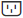
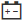

= Ver el estado y la configuración de los componentes de la estantería en SANtricity System Manager
:allow-uri-read: 
:experimental: 
:icons: font
:imagesdir: ../media/

[role="lead"]
La página Hardware proporciona el estado y la configuración de los componentes de la estantería, incluidas las fuentes de alimentación, los ventiladores y las baterías.

.Acerca de esta tarea
Los componentes disponibles dependen del tipo de shelf:

* *Estantería de unidades* -- Contiene un conjunto de unidades, canisters de alimentación/ventilador, módulos de entrada/salida (IOMs) y otros componentes de soporte en una sola estantería.
* *Estante de controladores* -- contiene un conjunto de unidades, uno o dos cartuchos de controladores, cartuchos de alimentación/ventiladores y otros componentes de soporte en un único estante.

.Pasos
. Selecciona *Hardware*.
. Selecciona la lista desplegable para el Controller Shelf o Drive Shelf y luego elige *View Settings*.
+
Se abre el cuadro de diálogo Shelf Components Settings, con pestañas que muestran el estado y la configuración relacionada con los componentes de la estantería. Dependiendo del tipo de estantería seleccionada, algunas pestañas descritas en la tabla podrían no aparecer.

+
[cols="25h,~"]
|===
| Pestaña | Descripción 

 a| 
Bandeja
 a| 
La pestaña *Shelf* muestra las siguientes propiedades:

** *Shelf ID* -- Identifica de forma única una estantería en la matriz de almacenamiento. El firmware del controlador asigna este número, pero puedes cambiarlo seleccionando menu:Shelf[Change ID].
** *Shelf path redundancy* -- Especifica si las conexiones entre la estantería y el controlador tienen métodos alternativos (Sí) o no (No).
** *Tipos de unidad actuales* -- Muestra el tipo de tecnología incorporada en las unidades (por ejemplo, una unidad SAS que es compatible con seguridad). Si hay más de un tipo de unidad, se muestran ambas tecnologías.
** *Número de serie* -- Muestra el número de serie de la estantería.

 a| 
IOM (ESM)
 a| 
La pestaña *IOMs (ESMs)* muestra el estado del módulo de entrada/salida (IOM), que también se llama módulo de servicio ambiental (ESM). Supervisa el estado de los componentes en una bandeja de unidades y sirve como punto de conexión entre la bandeja de unidades y el controlador.

El estado puede ser Óptimo, Fallido, Óptimo (mal cableado) o Sin certificar. Otra información incluye la versión de firmware y la versión de la configuración.

Selecciona *Mostrar más ajustes* para ver las velocidades de datos máxima y actual, y el estado de la comunicación de la tarjeta (Sí o No).

[NOTE]
====
También puedes ver este estado seleccionando el icono IOM image:../media/sam1130-ss-hardware-iom-icon.gif[""] junto a la lista desplegable Shelf.

====

 a| 
Fuentes de alimentación
 a| 
La pestaña *Fuentes de alimentación* muestra el estado del contenedor de la fuente de alimentación y de la propia fuente de alimentación. El estado puede ser óptimo, fallido, retirado o desconocido. También muestra el número de pieza de la fuente de alimentación.

[NOTE]
====
También puedes ver este estado seleccionando el icono de Fuente de alimentación  junto a la lista desplegable Shelf.

====

 a| 
Ventiladores
 a| 
La pestaña *Ventiladores* muestra el estado del recipiente del ventilador y del propio ventilador. El estado puede ser óptimo, fallido, retirado o desconocido.

[NOTE]
====
También puedes ver este estado seleccionando el icono del ventilador , junto a la lista desplegable de Shelf.

====

 a| 
Temperatura
 a| 
La pestaña *Temperatura* muestra el estado de la temperatura de los componentes de la estantería, como los sensores, los controladores y los canisters de alimentación/ventilador. El estado puede ser Óptimo, Temperatura nominal superada, Temperatura máxima superada o Desconocido.

[NOTE]
====
También puedes ver este estado seleccionando el icono de Temperatura , junto a la lista desplegable Shelf.

====

 a| 
Baterías
 a| 
La pestaña *Baterías* muestra el estado de las baterías del controlador. El estado puede ser óptimo, fallido, retirado o desconocido. Otra información incluye la edad de la batería, los días hasta el reemplazo, los ciclos de aprendizaje y las semanas entre ciclos de aprendizaje.

[NOTE]
====
También puedes ver este estado seleccionando el icono de Baterías  junto a la lista desplegable Shelf.

====

 a| 
SFP
 a| 
La pestaña *SFPs* muestra el estado de los transceptores Small Form-factor Pluggable (SFP) en los controladores. El estado puede ser óptimo, fallido o desconocido.

Selecciona *Mostrar más configuraciones* para ver el número de pieza, el número de serie y el proveedor de los SFP.

[NOTE]
====
También puedes ver este estado seleccionando el icono SFP  junto a la lista desplegable Shelf.

====
|===
. Haz clic en *Cerrar*.

