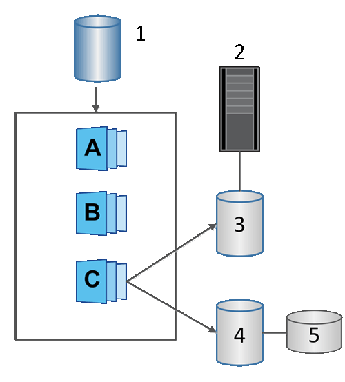

= Conoce los volúmenes de instantáneas en el software SANtricity
:allow-uri-read: 
:icons: font
:imagesdir: ../media/

[role="lead"]
Puedes crear un volumen de instantánea y asignarlo a un host si quieres leer o escribir datos de instantánea. El volumen de instantánea comparte las mismas características que el volumen base (nivel RAID, características de I/O, y así sucesivamente).

Cuando creas un volumen snapshot, puedes designarlo como __solo lectura__ o _accesible de lectura y escritura_.

Cuando creas volúmenes de instantáneas de solo lectura, no necesitas añadir capacidad reservada. Cuando creas volúmenes de instantáneas de lectura y escritura, debes añadir capacidad reservada para proporcionar acceso de escritura.

^1^ Volumen base; ^2^ Host; ^3^ Volumen snapshot de solo lectura; ^4^ Volumen snapshot de lectura y escritura; ^5^ Capacidad reservada
