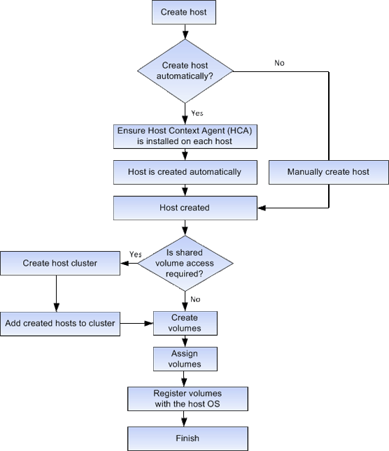

= Cómo funciona la creación de hosts y la asignación de volúmenes en SANtricity System Manager
:allow-uri-read: 
:icons: font
:imagesdir: ../media/

[role="lead"]
La siguiente figura muestra cómo configurar el acceso al host.

