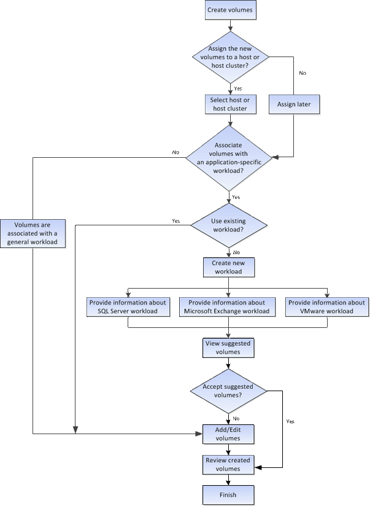

= Cómo funciona la creación de volúmenes en SANtricity System Manager
:allow-uri-read: 
:icons: font
:imagesdir: ../media/

[role="lead"]
En SANtricity System Manager, puedes crear volúmenes siguiendo estos pasos.

