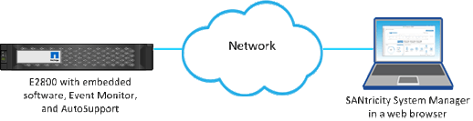

= Conoce cómo acceder a SANtricity System Manager desde Unified Manager
:allow-uri-read: 
:icons: font
:imagesdir: ../media/

[role="lead"]
Seleccionas una o más matrices de almacenamiento y usas la opción Launch para abrir SANtricity System Manager cuando quieres configurar y administrar matrices de almacenamiento.

System Manager es una aplicación integrada en los controladores, que se conecta a la red a través de un puerto de gestión Ethernet. Incluye todas las funciones basadas en el array.

Para acceder a System Manager, debes tener:

* Uno de los modelos de array que aparecen aquí: link:https://docs.netapp.com/us-en/e-series/getting-started/learn-hardware-concept.html["Descripción general del hardware de E-Series"^]
* Una conexión fuera de banda a un cliente de gestión de red con un navegador web.

